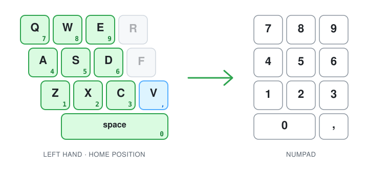

<div align="center">

# QweNumpad

**Type numbers with your left hand.**<br>
`qwe` `asd` `zxc` become a numpad — automatically, only inside numeric fields.

[](https://github.com/Muratmd/QweNumpad/actions/workflows/build.yml)
[](https://github.com/Muratmd/QweNumpad/releases/latest)
[](LICENSE)




**[⬇ Download QweNumpad.exe](https://github.com/Muratmd/QweNumpad/releases/latest)** · single file · no install · no .NET needed

</div>

---

No reaching for the number row. No numpad required. The 3x3 letter block under your left
hand already has the same shape as the numpad's digit block, so QweNumpad maps one onto the other.

**The point is that you don't switch modes by hand.** When focus lands in a field that wants
digits — a phone number, an amount, an IBAN, a quantity — the mapping turns itself on. When you
focus a normal text field, it turns itself off. Letters stay letters everywhere else.

> **🇹🇷 Türkçe:** Sol elinin altındaki `qwe` `asd` `zxc` tuşları, sayısal bir alana
> (telefon, tutar, IBAN, adet…) tıkladığın anda kendiliğinden numpad'e dönüşür; normal metin
> alanında harf olarak kalır. Yanlış tahmin ederse `Ctrl`+`Alt`+`N` ile düzelt — o alanı
> öğrenir, bir daha doğru açılır. Arayüz Türkçe. [İndir](https://github.com/Muratmd/QweNumpad/releases/latest).

## Status

Working and tested on Windows 11. Verified end to end with real injected keystrokes
(`tools/smoke-test.ps1`, `tools/browser-test.ps1`): `input type=number` and a text input named
"Telefon Numarasi" both remap correctly, a plain text input is left alone, and `Shift` bypasses
the mapping.

The user interface strings are currently Turkish. Localization PRs are very welcome — see
[Contributing](#contributing).

## How detection works

On every focus change, the first rule that matches wins:

| # | Signal | Example |
|---|--------|---------|
| 1 | A rule you taught with the override hotkey | anything you corrected once |
| 2 | UI Automation `RangeValue` pattern or `Spinner` control type | `<input type="number">`, spin boxes |
| 3 | Win32 `ES_NUMBER` window style | native edit controls that accept digits only |
| 4 | Keyword in the field's name / automation id / help text | `txtTelefonNo`, `Kart Numarası`, `amount_due`, `IBAN` |
| 5 | nothing matched | mapping stays off |

Password fields and read-only fields are **never** remapped.

### When detection gets it wrong

It will, sometimes. Electron, Qt, Java and custom-drawn applications often expose every field as a
generic "Edit" with no name, and there is nothing in the accessibility tree to tell a phone number
from a surname.

That is what the override hotkey is for:

**`Ctrl` + `Alt` + `N`** cycles `Auto → Forced on → Forced off → Auto`

And the override teaches: the field you corrected is remembered by its signature
(process name + control type + automation id + label), so the next time you focus that same field
the automatic decision is already right. In the applications you actually use, accuracy climbs
toward 100% as you go.

Numbers inside a label are ignored when matching, so a rule taught on "Tutar: 150 TL" still
applies when the same field later reads "Tutar: 2300 TL", and one taught on row 3 of a grid
applies to row 12.

The tray menu also has explicit **"teach this field as numeric / as text"** entries, and
**Diagnostics** shows exactly what the detector saw — open that first if something misbehaves.
It has a **copy** button that produces exactly what a bug report needs.

### Escape hatches

| Hold | Result |
|------|--------|
| `Shift` | no mapping — `Shift`+`q` gives `Q`, so you can always type a letter |
| `Ctrl` / `Alt` / `Win` | no mapping — `Ctrl`+`A`, `Ctrl`+`C` etc. keep working |

## Install

Download `QweNumpad.exe` from [Releases](../../releases) and run it. It is a single
self-contained file — no .NET installation needed, nothing is written outside
`%APPDATA%\QweNumpad\`.

It is a ~63 MB download, because `System.Windows.Automation` pulls the WPF assemblies in.
Replacing that with direct `UIAutomationCore` COM interop would cut it a lot and is a
welcome contribution.

The app lives in the notification area. Double-click the tray icon for settings.

Icon colour tells the state:

| Colour | Meaning |
|--------|---------|
| grey | automatic, currently off |
| green | automatic, currently on |
| blue | forced on |
| red | forced off |

### Build from source

```powershell
git clone https://github.com/Muratmd/QweNumpad.git
cd QweNumpad
dotnet test
dotnet publish src/QweNumpad.App/QweNumpad.App.csproj -c Release
```

The executable lands in `src/QweNumpad.App/bin/Release/net8.0-windows/win-x64/publish/`.

Requires the .NET 8 SDK (or newer) and Windows.

## Security: read this before you install a keyboard hook

QweNumpad uses `WH_KEYBOARD_LL`, the same Windows API a keylogger uses. You should be
suspicious of that, so here is exactly what it does and does not do:

- **Keystrokes are never logged, never written to disk, never sent anywhere.** The hook
  reads a virtual key code, decides, and returns.
- **There is no networking code in this project at all.** No HTTP client, no telemetry,
  no update check. You can verify this: `grep -ri "http\|socket\|WebClient" src/`
- **The only thing written to disk** is `%APPDATA%\QweNumpad\learned.json` and
  `settings.json`. `learned.json` holds field *metadata* — process name, control type,
  automation id, label text — so a corrected guess stays corrected. It never contains
  anything you typed.
- **It does not run elevated** (`asInvoker` in the manifest). As a consequence it cannot
  remap keys inside elevated windows such as Task Manager or UAC prompts. That is the
  correct trade-off for a keyboard hook.
- **Your antivirus may warn about it.** A low-level keyboard hook in an unsigned binary is
  a textbook heuristic match. Build it yourself from source if you would rather not trust
  a downloaded binary — that is why the build is three commands.

## How it is put together

```
src/QweNumpad.Core/        pure logic, no UI, no Win32 — this is what the tests cover
  KeyMap.cs                physical key -> numpad key table
  MappingEngine.cs         the per-keystroke decision
  ModeState.cs             auto / forced on / forced off
  FieldSignature.cs        how a field is identified and described
  FieldHeuristics.cs       rules 2-4 of the detection table
  LearnedFieldStore.cs     your corrections, as JSON
  FieldClassifier.cs       learned rules beat heuristics
  AppSettings.cs           hotkey, custom map, keywords

src/QweNumpad.App/         WinForms tray application
  Input/LowLevelKeyboardHook.cs   WH_KEYBOARD_LL
  Input/KeystrokeRouter.cs        keeps key-down and key-up paired
  Input/KeyOutputSender.cs        SendInput, with the Num Lock fallback
  Detection/UiaFocusWatcher.cs    UI Automation focus tracking
  Ui/                             tray icon, settings, diagnostics

tests/QweNumpad.Core.Tests/   74 unit tests
tools/                        end-to-end test scripts
```

Two design decisions worth knowing if you are going to touch the code:

**The keyboard hook never calls UI Automation.** The hook callback blocks all keyboard input
system-wide until it returns, and UIA property reads are COM calls that can take tens of
milliseconds. Detection runs on the focus-change event instead, and the hook only reads a
`volatile bool`. Break this and the whole machine's typing feels broken.

**Num Lock is handled, not assumed.** `VK_NUMPAD7` only means `7` while Num Lock is on —
with it off, it means `Home`. So when Num Lock is off, QweNumpad sends the top-row digit key
instead, rather than silently toggling your Num Lock.

## Testing

```powershell
dotnet test                                                        # 74 unit tests
powershell -ExecutionPolicy Bypass -File tools\smoke-test.ps1      # end to end, in-app
powershell -ExecutionPolicy Bypass -File tools\browser-test.ps1    # end to end, in a browser
```

The two script tests inject real keystrokes with `SendInput` and read the results back through
UI Automation. They take over your keyboard for about 20 seconds, so don't type while they run.

## Contributing

Issues and pull requests welcome. Things that would genuinely help:

- **English (and other) UI strings** — all user-facing text is Turkish and hardcoded today.
- **Keyword lists for other languages** — `FieldHeuristics.LongKeywords` is Turkish + English.
- **Detection for stubborn toolkits** — if a program you use always guesses wrong, open the
  Diagnostics window, press **copy**, and paste it into a
  [bug report](https://github.com/Muratmd/QweNumpad/issues/new/choose) along with what the
  field actually is.
- **An on-screen indicator** — some people will want more than a tray icon colour.

If you add logic, add it to `QweNumpad.Core` with a test. The Core project deliberately has no
Win32 or WinForms dependency so it stays testable.

## License

[MIT](LICENSE)
